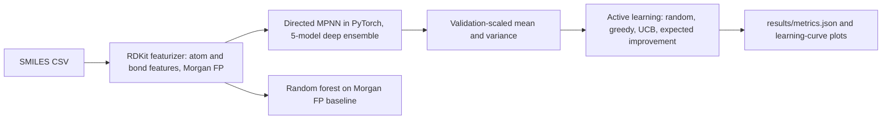

# Active-learning virtual screening with a graph neural network

This project trains a message-passing neural net on molecular graphs to predict aqueous solubility (ESOL) and lipophilicity, estimates uncertainty with a deep ensemble, and runs a pool-based active-learning loop that decides which molecules to evaluate next. Measured assay values stand in for an expensive physics oracle. Random, greedy, upper-confidence-bound, and expected-improvement acquisition are compared by how many of the top 5% of lipophilicity values each finds inside a fixed evaluation budget.

## Setup

From this folder, on Python 3.11 or 3.12:

```text
python -m venv .venv
.venv\Scripts\pip install -r requirements.txt
```

PyTorch is pinned to the CPU wheel. The first line of `requirements.txt` points pip at `https://download.pytorch.org/whl/cpu`.

## How to run

```text
python run.py
```

Optional flags:

- `python run.py --quick` runs the same steps on a small subset with one epoch. It is for tests and smoke checks and finishes in a few minutes. It does not target the numeric success criteria.
- `python run.py --device cuda` uses a GPU when one is available. The default is CPU.
- `--data-dir` and `--results-dir` override the default `data/` and `results/` folders.

`python run.py` downloads the CSVs into `data/` (cached, checksum-checked), builds a Bemis-Murcko scaffold split, trains the ensemble and the fingerprint random forest, writes predictions, runs the active-learning simulator, and writes `results/metrics.json` plus the plots below. No shell scripts or notebooks are required.

## Architecture



## Design decisions

- The network is a directed message-passing model written in plain PyTorch. PyTorch Geometric is not used, so the CPU install stays simple on Windows.
- A 2048-bit Morgan fingerprint is projected and concatenated with the pooled atom states. Ten RDKit 2D descriptors (including molecular weight, polar surface area, and Crippen logP) are concatenated as well, with a zero-initialized linear skip so the graph model starts as the whole predictor and can learn a descriptor correction. The random-forest baseline uses only the fingerprint.
- Five models trained from different seeds form a deep ensemble. A single scale on the ensemble standard deviation is chosen so that 90% intervals cover about 90% of the validation molecules. That scale is not fit on the test set.
- The scaffold split puts every Bemis-Murcko scaffold entirely into train, validation, or test. Early stopping uses validation RMSE. The test split is scored once after the models are frozen.
- The active-learning pool is the lipophilicity train and validation molecules. Test-scaffold labels are not placed in the oracle, so they cannot be used to train the screening models or to choose the next batch.
- Top 5% means the highest experimental logD values in that pool. Ties break toward the smaller molecule id. Greedy, UCB (mean plus kappa times std, kappa 1), and expected improvement all maximize logD. The reported multiplier is the best of those three strategies divided by random, averaged over the same five seeds and the same initial labeled sets.
- Later active-learning rounds warm-start from the previous weights and keep the target standardization from the first fit, so a short update stays on the same scale.

## Limitations

- The oracle is a public assay label, not docking or free-energy simulation.
- Molecules are 2D graphs. Stereochemistry enters only as an atom feature, and conformers are not modeled.
- Ensemble variance is a heuristic. The validation scale corrects the average interval width, not every local bias.
- The model is sized to train on CPU within the project time budget, so it is smaller than a production chemprop run.
- Scaffold splits still share broad chemical series across the cut, and a single scalar uncertainty calibration can miss dataset shift.

## Data

- ESOL (Delaney), 1,128 molecules, public research data: [delaney-processed.csv](https://deepchemdata.s3-us-west-1.amazonaws.com/datasets/delaney-processed.csv). Target: measured log solubility in mol/L.
- Lipophilicity, 4,200 molecules from ChEMBL, CC BY-SA 3.0: [Lipophilicity.csv](https://deepchemdata.s3-us-west-1.amazonaws.com/datasets/Lipophilicity.csv). Target: experimental logD.
- Both files are cached under `data/` and checked against a SHA-256 checksum and a row count before training.
- MoleculeNet described these benchmarks (Wu et al., 2018). The scaffold split follows the usual Bemis-Murcko protocol used by DeepChem.

## Tests

```text
python -m pytest --cov=molprop --cov-report=term-missing
```

## Results

<!-- RESULTS_START -->
Results are filled in by `python run.py` from `results/metrics.json`.
<!-- RESULTS_END -->
