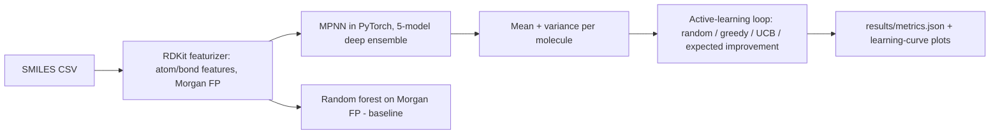

# Active-Learning Virtual Screening with a Graph Neural Network Surrogate

`molprop-active-learning` · new project · estimated build effort: 4 h

## Problem

Hit discovery spends expensive physics-based evaluations (docking, free-energy calculations) on a small fraction of a compound library. This project trains a message-passing GNN on molecular graphs to predict measured properties (aqueous solubility, lipophilicity), quantifies its uncertainty with a deep ensemble, and runs a pool-based active-learning loop that picks which molecules to "evaluate" next. The measured labels act as the expensive oracle. It compares acquisition strategies by how many of the top-5% molecules each finds within a fixed evaluation budget.

## Target jobs and skills

- **Schrödinger — Scientific Machine Learning Engineer** (`9ebe7329afd2`): covers 88% of the JD's weighted top skills (Python, PyTorch, Machine Learning, Active Learning, Cheminformatics, Scientific ML, Uncertainty Quantification, Graph Neural Networks, Git)

Skills/tools this project demonstrates: Python, PyTorch, Machine Learning, Deep Learning, Graph Neural Networks, Active Learning, Cheminformatics, Uncertainty Quantification, Scientific ML, Regression, Model Evaluation, Git

## Data

- **Dataset:** MoleculeNet ESOL (Delaney, 1,128 molecules) and Lipophilicity (4,200 molecules from ChEMBL) — https://deepchemdata.s3-us-west-1.amazonaws.com/datasets/delaney-processed.csv and .../datasets/Lipophilicity.csv
- **License/terms:** ESOL public research data; Lipophilicity from ChEMBL, CC BY-SA 3.0
- **Size used:** ~5.3k SMILES strings, < 5 MB
- **Plan:** Scaffold split (Bemis-Murcko) 80/10/10 with a fixed seed so test scaffolds are unseen in training.

## Architecture

## Tech stack

Python 3.11, PyTorch (CPU), RDKit, scikit-learn, pandas, matplotlib, pytest

## Deliverables

- Featurizer and message-passing GNN written in plain PyTorch (no PyTorch Geometric, so it installs cleanly on Windows)
- Deep-ensemble uncertainty with a calibration check (interval coverage)
- Pool-based active-learning simulator with 4 acquisition functions and repeated runs over 5 seeds
- Plots of test RMSE vs. training size and top-5% hit recovery vs. budget

## Success criteria (all must hold on a from-scratch `python run.py`)

| Metric | Threshold | How it is measured |
|---|---|---|
| ESOL test RMSE (scaffold split) | <= 0.90 log mol/L and lower than the RF baseline | ensemble mean on held-out scaffolds |
| Lipophilicity test RMSE (scaffold split) | <= 0.85 log D and lower than the RF baseline | ensemble mean on held-out scaffolds |
| 90% prediction-interval coverage | between 0.80 and 0.97 | fraction of test molecules inside mean +/- 1.645 sd |
| Top-5% hit recovery at 20% budget (Lipophilicity pool) | >= 1.5x random acquisition, mean of 5 seeds | AL simulator |
| Test coverage of src/ | >= 70% | pytest --cov |

## Evaluation artifacts (required; the evaluator recomputes metrics from these)

- results/splits/<dataset>_split.csv: id, smiles, scaffold, split (train/val/test) - one file per dataset
- results/predictions/<dataset>_<model>_test.csv: id, y_true, y_pred, y_std (y_std empty for the RF baseline) - for models gnn_ensemble and rf_baseline on both datasets
- results/active_learning/trace.csv: strategy, seed, round, n_labeled, selected_ids (semicolon-separated ids picked this round) - the initial labeled set is round 0
- results/active_learning/pool.csv: id, smiles, y_true, is_top5 for the pool used by the AL simulation

## Baseline

Random forest (500 trees) on 2048-bit Morgan fingerprints for property prediction; random acquisition for active learning.

## Constraints

- Runs on Windows with `python run.py` from a fresh virtualenv; no make, shell scripts, paid APIs, or accounts.
- CPU-only by default (an optional `--device cuda` flag is fine); peak RAM <= 3 GB; total downloads <= 1.5 GB.
- PyTorch (if used) pinned to the CPU wheel via `--extra-index-url https://download.pytorch.org/whl/cpu`.
- Fixed random seeds; every reported number is written by code to results/metrics.json (never typed by hand).
- Test split is created once, saved, and never used for training, tuning, or threshold selection.
- Data download is scripted (Python requests), cached under data/, and verified by checksum or row count.
- Active learning must never read oracle labels for molecules it has not "evaluated"; tests check this.
- Full `python run.py` must finish in <= 45 minutes on an 8-core CPU: size the GNN (e.g. 3 message-passing layers, hidden 128), epochs, AL batch size, and rounds to fit; warm-starting the ensemble between AL rounds is allowed.

## Draft resume bullets (placeholders are filled only with reproduced metrics)

- Built a message-passing GNN ensemble in PyTorch for molecular property prediction, reaching [ESOL_RMSE] RMSE on scaffold-split ESOL vs. [RF_RMSE] for a fingerprint random forest
- Ran an active-learning screening loop that recovered [HIT_MULT]x more top-5% molecules than random selection at a 20% evaluation budget
- Quantified prediction uncertainty with a 5-model deep ensemble ([COVERAGE] coverage of 90% intervals) to choose which molecules to evaluate next
